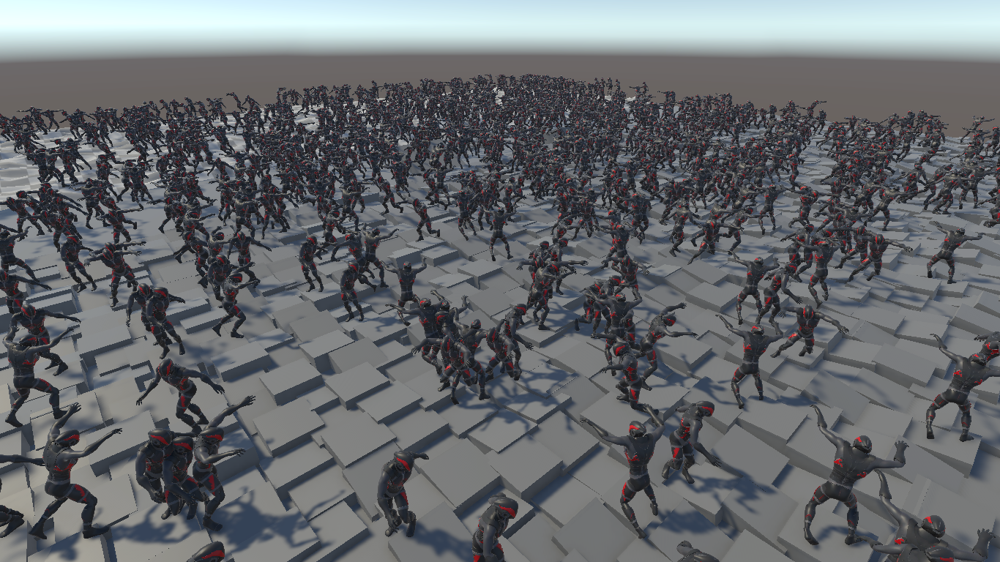
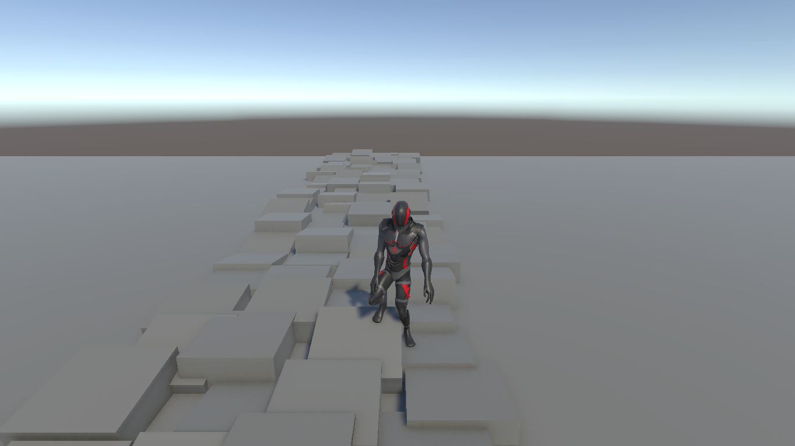

# Animation Tech Demo

A Unity 6 character animation tech demo built on the Playables API. Instead of Animator
Controllers, characters run on custom `PlayableGraph`s with Burst-compiled `IAnimationJob`s.
The main feature is procedural foot placement on uneven ground, scaled up to many agents with
batched physics queries.

## Scenes

Scenes are in `Assets/TechDemo/Scenes`.

### MultipleWalkers

The stress test: 1000 agents wander over uneven ground, all with foot placement.

- **Agents:** `AgentsSpawner` places the agents at random positions. Each agent picks a random
  target, idles for 2 to 5 seconds, walks there with root motion, and repeats.
- **Animation:** each agent has its own `PlayableGraph`, with an idle and walk mixer followed by
  the `FootPlacementPostProcess` IK job.
- **Foot casts:** `SpherecastHandler` runs the heel and toe casts for every agent as one batch of
  `SpherecastCommand`s, which is 4000 casts per frame.
- **Ground following:** `AnimatorsMoveRaycastHandler` applies root motion and follows the ground
  in one batch of `RaycastCommand`s and transform jobs, which is 1000 rays per frame.
- **Terrain:** `IrregularPathSpawner` lays out 50 lines of randomly placed and tilted platforms,
  alongside inclines and bumps.

**Controls:** WASD moves the camera, and holding the right mouse button looks around.

### SingleWalkerCourse

A close-up of foot placement: you walk one character over a course that tests each part of it.

- **Character:** `RootMotionWalker` moves the character with root motion. It turns toward the
  camera-relative WASD direction and crossfades between idle and walk.
- **Foot placement:** `FootPlacementPostProcess` matches each foot's height and tilt to the
  ground, lowers the pelvis to reach low ground, and eases the result to avoid snapping.
- **Debugging:** with Gizmos on, each cast is drawn in the Scene view: green for a hit, with its
  normal in blue, and red for a miss.

**Controls:** WASD walks the character, and `FollowCamera` follows it.

### Other scenes

| Scene | Shows |
|---|---|
| `FootPelvisIk` | Foot IK with pelvis adjustment and foot tilt |
| `SimpleFootIk` | Basic foot IK with ground raycasts |
| `TwoBoneIk` | Two-bone IK reaching for an effector |
| `LookAt` | Rotating a joint toward a target |
| `SimpleMix` | Blending two clips with a custom animation job |

## Features

- **Custom animation graphs:** clips are mixed with `AnimationMixerPlayable`, and post-process
  steps are added through `AnimationScriptPlayable`.
- **Two-bone IK:** an analytic solver that runs on the animation stream inside jobs.
- **Foot placement:**
  - Sphere casts under each heel and toe measure the ground.
  - Each foot's height and tilt are matched to the ground, with the tilt limited to a set angle.
  - The pelvis lowers so that a foot can reach ground below the root.
  - The toe is lifted when a clamped tilt would push it into the ground.
- **Stable results:**
  - Casts start from the animated pose rather than the IK result, which avoids a feedback loop.
  - The IK output is eased with a frame-rate independent exponential.
  - Feet rise faster than they drop, and the pelvis moves slowest so the body doesn't bob.
- **Root motion locomotion:** characters move with the walk clip's root motion and follow the
  ground height.
- **Batched queries for crowds:** `SpherecastCommand` and `RaycastCommand` run all casts for all
  agents as jobs, in place of one physics call per agent.

## Notable scripts

Scripts are in `Assets/TechDemo/Scripts`.

| Script | Purpose |
|---|---|
| `FootPlacementPostProcess` | Foot and pelvis IK job, added to a walker's graph |
| `TwoBoneIkSolver` | Shared two-bone IK solver |
| `IAnimationPostProcess` | Interface for adding a step between the mixer and the output |
| `RootMotionWalker` | Character driven by WASD and root motion |
| `AgentWalker` | Character that idles, then walks to random targets |

## Requirements

- Unity `6000.3.18f1`
- Universal Render Pipeline
- Input System package

## Running

1. Open the project in Unity.
2. Open a scene from `Assets/TechDemo/Scenes`.
3. Press Play.
